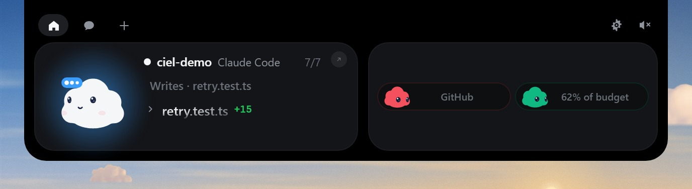
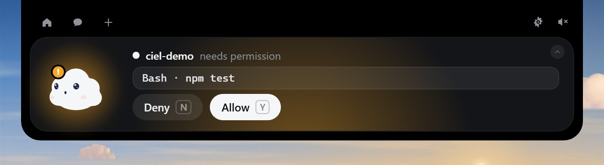
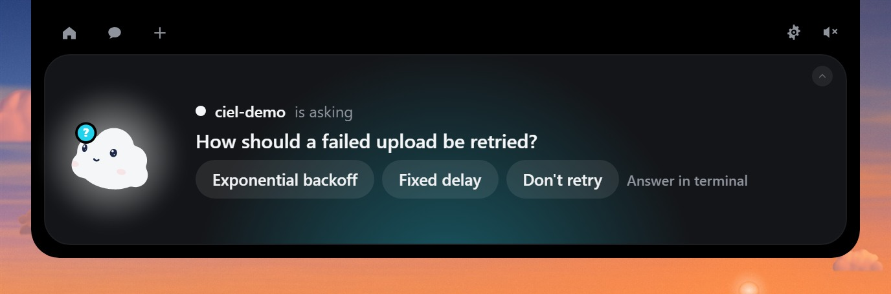
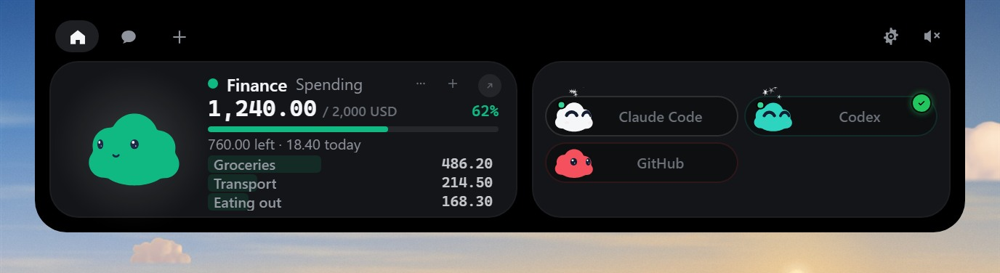
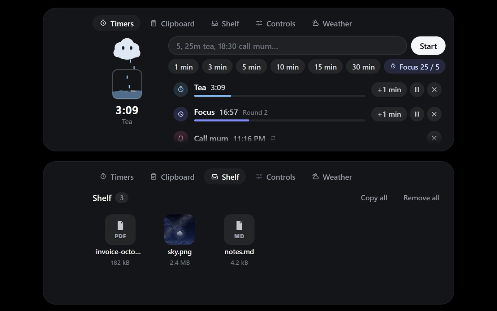
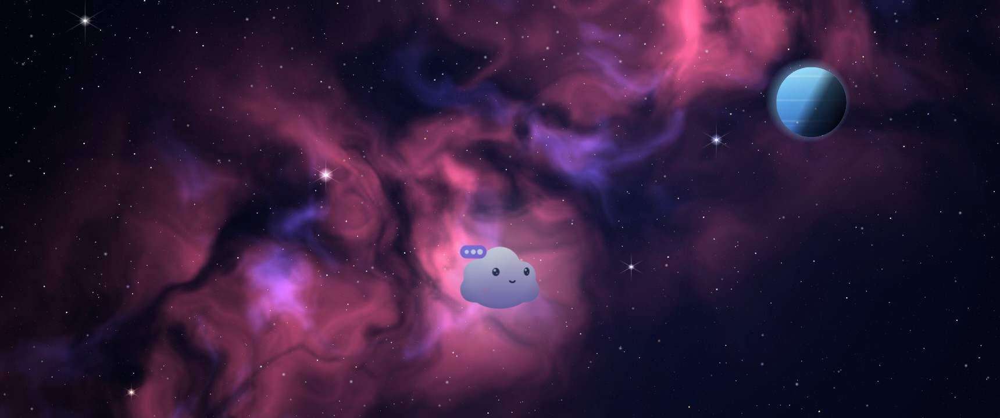

<div align="center">


# Ciel

**A little cloud at the top of your screen. It watches your AI coding agents, asks before anything runs, and looks after the small things of your day.**

[](https://github.com/jean-eudes-asg/ciel/releases/latest)
[](https://github.com/jean-eudes-asg/ciel/actions/workflows/ci.yml)


[](LICENSE)

**[Website](https://jean-eudes-asg.github.io/ciel/)** ·
**[Try it in your browser](https://jean-eudes-asg.github.io/ciel/#try)** ·
**[Download](https://github.com/jean-eudes-asg/ciel/releases/latest)** ·
**[Changelog](CHANGELOG.md)**


</div>

Ciel lives in a small island at the top of your screen, on Windows and Linux. It
shows what Claude Code, Codex and your other agents are doing, puts their
permission requests and questions in front of you, and gets out of the way the
rest of the time. Around that it keeps your timers, your clipboard and your
dropped files, takes your dictation, notes your calls, answers « OK Ciel », and
paints your desktop with a sky that follows the real sun.

You don't need to code to use it. It is free, open source, has no telemetry and
no account, and can run entirely on your own computer.

## Contents

- [Highlights](#highlights)
- [See it](#see-it)
- [Install](#install)
- [Getting started](#getting-started)
- [Features](#features)
- [Supported agents](#supported-agents)
- [Run everything on your computer](#run-everything-on-your-computer)
- [Privacy and security](#privacy-and-security)
- [Keyboard shortcuts](#keyboard-shortcuts)
- [How it works](#how-it-works)
- [Development](#development)
- [Contributing](#contributing)
- [Credits](#credits)
- [License](#license)

## Highlights

- **One place for every agent.** Claude Code, Codex, Cursor, Gemini CLI, Copilot
  CLI and more, each session live in the island with its steps and its diffs.
- **Nothing runs without you.** Allow, Deny and answer questions from the
  island. If Ciel is not running, the agent asks in its own terminal.
- **Useful when you are not coding.** Timers, clipboard history, a file shelf,
  quick settings, a calendar and the weather.
- **Voice that stays on your computer.** Hold a key to dictate anywhere, say
  « OK Ciel », record a call and get its summary and to-dos.
- **Local-first.** Chat, voice and summaries can all run on a local model.
- **Made in code.** The character, the icon, the skies and the 29 sounds are
  all generated from source in this repository.

## See it

<table>
<tr>
<td width="50%"></td>
<td width="50%"></td>
</tr>
<tr>
<td><b>Your agents, live.</b> Every step a session reads, edits and runs, with the diff one click away.</td>
<td><b>Nothing runs without you.</b> Permission requests open the island with Deny and Allow.</td>
</tr>
<tr>
<td></td>
<td></td>
</tr>
<tr>
<td><b>Answer from anywhere.</b> Claude Code's questions show their options right in the island.</td>
<td><b>Your spending.</b> A Finance pill on two plain files you own, with « OK Ciel, I spent 12 euros on lunch ».</td>
</tr>
</table>

<div align="center">

</div>

The [website](https://jean-eudes-asg.github.io/ciel/#try) runs the real island
in demo mode, under a sky that follows Ciel's mood. The app has the same demo:
**Settings → General → Try demo mode**.

## Install

Every build is on the
[latest release](https://github.com/jean-eudes-asg/ciel/releases/latest) page.

| System | Package |
|---|---|
| Windows 10 and 11 | `Ciel-Windows-setup.exe` or `Ciel-Windows.msi` |
| Debian, Ubuntu 22.04+ | `Ciel-Linux-amd64.deb` |
| Fedora | `Ciel-Linux-x86_64.rpm` |
| Any other Linux | `Ciel-Linux-x86_64.AppImage` |

Linux builds run on X11 and Wayland.

```sh
sudo apt install ./Ciel-Linux-amd64.deb
```

**Windows warns you the first time.** The installer is not code-signed yet, so
SmartScreen does not know the publisher. Click **More info**, then **Run
anyway**.

**Check a download.** Each release carries a `SHA256SUMS` file:

```sh
sha256sum -c --ignore-missing SHA256SUMS
```

**Updates.** On Windows and with the AppImage, Ciel can update itself: the
check is opt-in, updates are signed, and one installs only when you click. With
the `.deb` or `.rpm`, Ciel tells you a new version is out and you install it
from the release page.

You can also [build it from source](#development).

## Getting started

1. Start Ciel. The first time, the Ciel window walks you through seven short
   steps: language, the tool you code with, how the island opens, the everyday
   tools, dictation, the pills and the sky.
2. Connect your agent: **Settings → Claude Code → Install hooks…**. You see the
   exact change to `~/.claude/settings.json` and where its dated backup goes,
   and nothing is written until you click. The other agents have the same page.
3. Start a session in your agent as usual. It shows up in the island.

Not coding? Pick **None** as the main tool (Island → Active pills → Main tool)
and the island is yours for the rest.

## Features

### Agents

- Sessions from Claude Code, Codex, Cursor, Gemini CLI, Copilot CLI,
  Antigravity, OpenCode, Amp, Hermes and Muse Code, and Claude Code sessions
  from the Claude desktop app.
- **Allow / Deny, questions and live diffs** in the island.
- Ciel does a happy little jump when a session finishes, and a weekly recap
  sums up the work.
- Ciel never allows anything on its own. See [Supported agents](#supported-agents).

### Everyday tools

A **Tools** tab in the island, for everyone:

- **Timers and reminders.** Type "25m tea" or "18:30 call mum". Repeating
  reminders, Snooze, and Focus rounds (25 minutes, 5 of break).
- **Clipboard history**, off until you turn it on. Text, links, pictures and
  files; links lose their trackers, colours show HEX, RGB and HSL, sums show
  their result. What password managers copy is never kept.
- **Shelf.** Files you drop on Ciel wait there a week, to ask about or drag
  into any app.
- **Controls.** Volume and output device, brightness, network, VPN, Bluetooth,
  power mode, night light, dark style, do not disturb, battery, keep awake,
  screenshot, lock and a power menu, plus your pinned apps.
- **Calendar.** The month with your events, and world clocks.
- **Weather** from Open-Meteo, free and without an account, with rain alerts.

What matters shows in the folded island in place of the clock: a timer counting
down, "Mic off", rain coming, the line of the song playing.

### Voice

- **Flow dictation.** Hold **Right Ctrl** anywhere, speak, let go: your words
  are pasted where you type. Offline, with
  [Parakeet](https://huggingface.co/nvidia/parakeet-tdt-0.6b-v3).
- **« OK Ciel ».** Say it, then ask: your next meetings, a timer, the weather,
  the music, what was decided in a call, "I spent 250 lira on groceries". It
  can answer out loud with a voice made on your computer (Kitten or Kokoro).
- **Notetaker.** Record a call (your microphone and what your PC plays) and get
  the transcript, a summary and the to-dos. Meetings from your calendar get a
  card with **Join** and **Take notes** a few minutes ahead.
- **Answers during a call.** Press **Ctrl+Alt+K** while the Notetaker records:
  Ciel finds the last question put to you and suggests an answer on a card,
  from the call so far, your company folder and earlier calls.

### Chat and integrations

- **Chat** with Claude, OpenAI, Google AI, OpenRouter or a local model.
- **Pills**, each with its own coloured mini cloud: GitHub, Vercel, Stripe,
  n8n, Resend, Notion, Cal.com, Gmail, Calendar, Spotify, YouTube Music,
  Finance, System (CPU, memory, disk, temperature) and Alerts (Grafana,
  Alertmanager, Uptime Kuma, Zabbix).
- **Notifications in the island.** New mail in Gmail, and what websites in
  Chrome, Edge or Brave notify (WhatsApp, Calendar, Slack…) through the
  [Ciel for Chrome](extension/) extension, instead of the browser's popups.
- **Music** with timed lyrics, from any player on Linux.

### Sky, wallpapers and lock screen

Skies drawn in code and lit by the real sun where you are, with the weather
following Ciel's mood: clear while he works, golden when he waits for you, a
storm on errors, stars when he sleeps. Live on your desktop, behind your icons
(it pauses when a window or a game covers it); a calm still picture on your
lock screen.

<table>
<tr>
<td></td>
<td></td>
</tr>
<tr>
<td></td>
<td></td>
</tr>
</table>

Or free photos from NASA (public domain) and Wikimedia Commons, credited. There
is also a flip-clock screensaver. All of it is off until you turn it on, with
one click to restore your own wallpaper and lock screen.

### Games

Five games for a break between two tasks: **chess**, **international
draughts** and a **maze**, played against five clouds of Ciel's family, each
with his own face, sky and way of playing, plus the **Clouds** sliding puzzle
and **Constellations**. They open in the Ciel window or in a window of their
own.

### The Ciel window

Pitch black or white, in five places: **Today**, **Island**, **Voice**, **Sky**
and **Preferences**. The interface is in 10 languages: English, 简体中文,
हिन्दी, Español, العربية, Français, বাংলা, Português (Brasil), Русский and
Bahasa Indonesia.

## Supported agents

| Agent | Installs | Permissions |
|---|---|---|
| Claude Code | `~/.claude/settings.json` | Allow / Deny and questions in the island |
| Codex | `~/.codex/hooks.json` (then trust the hooks once with `/hooks`) | Allow / Deny in the island |
| GitHub Copilot CLI | `~/.copilot/hooks/ciel.json` | Allow / Deny in the island |
| Muse Code | `~/.config/muse/settings.json` | Allow / Deny in the island |
| Gemini CLI | `~/.gemini/settings.json` | asked in Gemini CLI |
| Antigravity | `~/.gemini/config/hooks.json` | asked in Antigravity |
| Cursor Agent | `~/.cursor/hooks.json` | asked in Cursor |
| Claude desktop app | nothing: its Claude Code sessions are recognised | asked in the app |
| OpenCode · Amp · Hermes | a small plugin, installed from Settings | asked in the tool |
| Anything else | run `ciel-hook --agent <name> [<Event>]` from your tool's hooks | asked in the tool |

Paths are under your home folder, on Windows too. Every install makes a dated
backup, merges only Ciel's entries, shows you the diff and writes only after
you confirm.

## Run everything on your computer

Ciel's chat, « OK Ciel », dictation clean-up and call summaries can all run on a
local model, with no key and nothing sent anywhere. With
[Ollama](https://ollama.com), natively or in Docker:

```sh
docker run -d --name ollama --gpus all -p 11434:11434 -v ollama-models:/root/.ollama --restart unless-stopped ollama/ollama
docker exec ollama ollama pull qwen3.5:9b
```

Then **Settings → Chat**: connect Ollama, pick the model, and set **Ciel's
brain** to *Local model*. `qwen3.5:9b` (6.6 GB) runs well on an 8 GB graphics
card; on less, try `qwen3.5:4b`.

For « OK Ciel » to answer out loud on your computer too, pick **Kitten** in
**Settings → OK Ciel → Answers** and download it (about 63 MB, English only).

## Privacy and security

- **No telemetry, no account.** Ciel talks only to the services you connect.
- **Keys stay in the OS keychain**: Windows Credential Manager or the Linux
  Secret Service, never on disk.
- **Your voice never leaves the computer.** Only text goes to the AI providers
  you choose, and with a local model nothing goes anywhere.
- **You choose what Claude may read.** With Claude, « OK Ciel » reads only what
  you allow in **Settings → Chat → Ciel's brain**: your calendar and your call
  notes (their summaries, never what was said), and your spending only once
  you turn it on.
- **Nothing is approved or sent without your click.** No permission, no email.
- **Agents are never blocked.** If Ciel does not answer, `ciel-hook` exits at
  once and the agent asks in its own terminal.
- **Hide from screen sharing** (Windows) keeps your sessions, mail and notes
  out of shared screens and recordings.

## Keyboard shortcuts

| Keys | Does |
|---|---|
| Hold **Right Ctrl** | Dictate, pasted where you type |
| **Ctrl+Alt+U** | Mute or unmute every microphone |
| **Ctrl+Alt+V** | Clipboard history (once turned on) |
| **Ctrl+Alt+K** | Suggest an answer during a call |

All of them, and the rest, can be changed in the Ciel window under Shortcuts.

## How it works

```
 Claude Code, Codex, Cursor…          Chrome, Edge, Brave
        │ hooks                               │ native messaging
        ▼                                     ▼
    ciel-hook  ── named pipe / Unix socket ──▶  Ciel (Tauri 2)
   (tiny relay)     only your own user          Rust backend + TypeScript front end
```

Agents reach Ciel through `ciel-hook`, a small relay their hooks call, over a
named pipe (Windows) or a Unix socket (Linux) that only your own user can use.
The app is [Tauri 2](https://tauri.app): a Rust backend and a TypeScript front
end with no framework. It uses no CPU while the island is hidden.

| Path | What is there |
|---|---|
| `src/` | The front end. `cloud/` is the character, `island/` and `pill/` the island, `tools/`, `play/` (games), `sky/` (the sky renderer), `hub/` (the Ciel window) |
| `src-tauri/` | The Rust backend: windows, the pipe, AI providers, pollers, dictation (`flow/`), notes, « OK Ciel » (`voice/`), wallpaper |
| `hook/` | `ciel-hook`, the relay every agent's hooks call |
| `extension/` | Ciel for Chrome |
| `src/i18n/` | Every interface string, in 10 languages |
| `scripts/` | Generators for the icons and the sounds, and release packaging |
| `site/` | The website, drawn with the real sky renderer |
| `dev/` | Preview pages for development, not shipped |
| `tests/` | The front end's tests |

## Development

You need [Node 22.18+](https://nodejs.org) and [Rust](https://rustup.rs).

- **Windows:** the Visual Studio Build Tools with "Desktop development with C++".
- **Debian and Ubuntu:**

  ```sh
  sudo apt install libwebkit2gtk-4.1-dev libssl-dev libayatana-appindicator3-dev \
    librsvg2-dev libxdo-dev libasound2-dev libpulse-dev libdbus-1-dev \
    libgtk-layer-shell-dev
  ```

```sh
npm install
cargo build --release -p ciel-hook   # the app bundles the relay
npm run tauri dev                    # live-reloading development build
npm run pack                         # installers into release/
```

```sh
npm test && npx tsc --noEmit && cargo test --workspace   # all the tests
npm run icons    # redraws the icons from scripts/gen-icons.mjs
npm run sounds   # re-synthesizes the 29 sounds from scripts/gen-sounds.mjs
npm run site:dev # the website (site/); site:build writes site-dist/
```

`npx vite` serves the front end in a browser: `demo.html` plays the demo, and
`dev/` has preview pages (`cloud-preview.html`, `sky-preview.html`…).

Releases are built by GitHub Actions when a version tag is pushed
(`.github/workflows/release.yml`). Versions follow
[Semantic Versioning](https://semver.org), and every change is in the
[changelog](CHANGELOG.md).

## Contributing

Issues and pull requests are welcome. For anything large, open an issue first
so we can agree on the shape of it.

Before you open a pull request:

- Run the tests: `npm test && npx tsc --noEmit && cargo test --workspace`.
- Put every new interface string in `src/i18n/` in all 10 languages.
- Add a line to [`CHANGELOG.md`](CHANGELOG.md) for anything a user would notice.
- Keep the project's rules, written out in [`CLAUDE.md`](CLAUDE.md): no
  telemetry, keys only in the OS keychain, never block an agent, nothing
  approved or sent without the user's click.
- Art and sounds are generated in code. Please do not add any from elsewhere.

## Credits

Ciel is a fork of [Coucou](https://github.com/Louis-CFM/coucou) by Louis Raillé,
whose Windows and Linux app it builds on, under the MIT License. Coucou's name, its
character Mochi, its icon and its sounds belong to their author and are not part of
Ciel; Ciel's name, cloud character, icon and sounds are its own. Ciel is not made or
endorsed by Coucou's author.

Speech recognition uses NVIDIA's Parakeet through
[sherpa-onnx](https://github.com/k2-fsa/sherpa-onnx). Weather comes from
[Open-Meteo](https://open-meteo.com), lyrics from [lrclib.net](https://lrclib.net).
Space photos come from NASA, other photos from Wikimedia Commons, each with its
own credit.

## License

[MIT](LICENSE).
