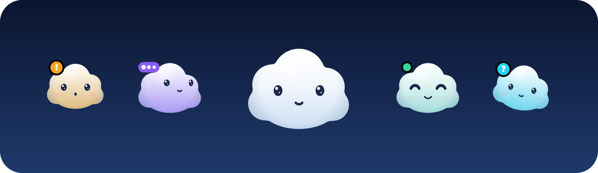
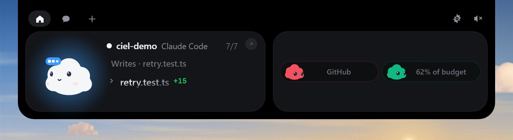
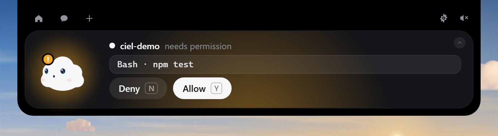
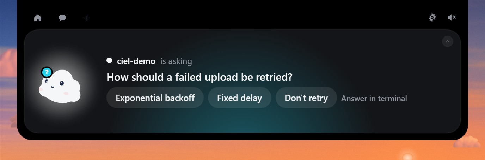
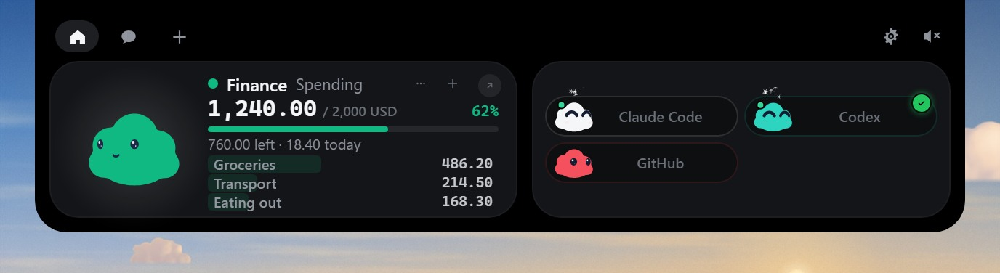
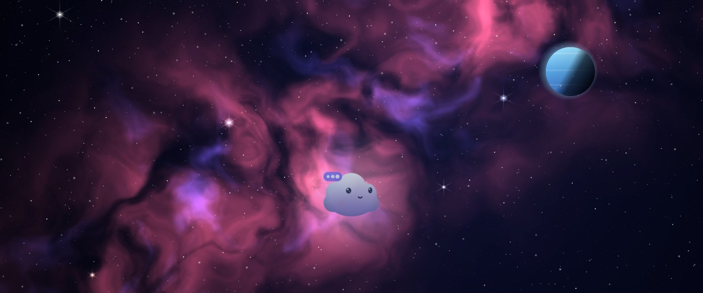

<div align="center">


# Ciel

**A little cloud at the top of your screen that keeps an eye on your AI coding agents.**

[](https://github.com/jean-eudes-asg/ciel/releases/latest)
[](https://github.com/jean-eudes-asg/ciel/actions/workflows/ci.yml)


[](LICENSE)

**[Website](https://jean-eudes-asg.github.io/ciel/)** ·
**[Download for Windows and Linux](https://github.com/jean-eudes-asg/ciel/releases/latest)** ·
**[Changelog](CHANGELOG.md)**



</div>

Ciel lives in a small island at the top of your screen. It shows what Claude Code,
Codex and your other agents are doing, asks you before anything runs, and gets out
of the way the rest of the time. It also takes your dictation, answers « OK Ciel »,
keeps an eye on your spending, and paints your desktop with a sky that follows the
real sun. It's free, open source, and it can run entirely on your own computer.

## See it

<table>
<tr>
<td width="50%"></td>
<td width="50%"></td>
</tr>
<tr>
<td><b>Your agents, live.</b> Every step a session reads, edits and runs, with the diff one click away.</td>
<td><b>Nothing runs without you.</b> Permission requests open the island with Deny and Allow.</td>
</tr>
<tr>
<td></td>
<td></td>
</tr>
<tr>
<td><b>Answer from anywhere.</b> Claude Code's questions show their options right in the island.</td>
<td><b>Your spending.</b> A Finance pill on two plain files you own, with « OK Ciel, I spent 12 euros on lunch ».</td>
</tr>
</table>

**[Try it in your browser](https://jean-eudes-asg.github.io/ciel/#try):** the website
runs the real island in demo mode, under a sky that follows his mood. In the app:
**Settings → General → Try demo mode**.

## What it does

- **Your agents.** Claude Code, Codex, Cursor, Gemini CLI, Copilot CLI,
  Antigravity, OpenCode, Amp, Hermes, Muse Code, and Claude Code sessions from
  the Claude desktop app. Ciel does a happy little jump when one finishes.
- **Allow / Deny, questions and live diffs** from the island. If Ciel isn't
  running, your agent simply asks in its own terminal: it never allows anything
  on its own.
- **Chat** with Claude, OpenAI, Google AI, OpenRouter or a local model.
- **« OK Ciel ».** Say it, then ask: your pills, music, your numbers, open an app,
  "I spent 250 lira on groceries". With Claude, or with a model on your computer.
- **Flow dictation.** Hold **Right Ctrl** anywhere, speak, let go: your words are
  pasted where you type. Offline, with [Parakeet](https://huggingface.co/nvidia/parakeet-tdt-0.6b-v3).
- **Notetaker.** Record a call (your microphone and what your PC plays), get the
  transcript, a summary and the to-dos.
- **Integrations**, each with its own coloured mini cloud: GitHub, Vercel,
  Stripe, n8n, Resend, Notion, Cal.com, Gmail, Spotify, YouTube Music and Finance.
- **Notifications in the island**: new mail in Gmail, and what websites in
  Chrome, Edge or Brave notify (WhatsApp, Calendar, Slack…) through the Ciel for
  Chrome extension, instead of the browser's popups.
- **Wallpapers and lock screen** drawn by Ciel (below).
- **Updates from the app** on Windows and with the AppImage: signed, opt-in,
  installed only when you click.
- Weekly recap, global shortcuts, Ciel on your desktop, 10 languages.

## Wallpapers and lock screen

Skies drawn in code and lit by the real sun where you are, with the weather
following Ciel's mood: clear while he works, golden when he waits for you, a storm
on errors, stars when he sleeps. Live on your desktop, behind your icons (it pauses
when a window or a game covers it); a calm still picture on your lock screen.

<table>
<tr>
<td></td>
<td></td>
</tr>
<tr>
<td></td>
<td></td>
</tr>
</table>

Or free photos from NASA (public domain) and Wikimedia Commons, credited. It's
off until you turn it on in **Settings → Wallpaper**, with one click to restore
your own wallpaper and lock screen.

## Install

**Windows 10/11:** download `Ciel-Windows-setup.exe` (or the `.msi`) from the
[latest release](https://github.com/jean-eudes-asg/ciel/releases/latest) and run it.

> Windows will warn you the first time: the installer isn't code-signed yet, so
> SmartScreen doesn't know the publisher. Click **More info**, then **Run anyway**.
> You can check a download against `SHA256SUMS` on the release page.

**Linux** (X11 and Wayland): from the same release, the `.deb` for Debian and
Ubuntu 22.04+, the `.rpm` for Fedora, or the AppImage for anything else.

```sh
sudo apt install ./Ciel-Linux-amd64.deb
```

Or [build it from source](#build-it-yourself).

Then open **Settings → Claude Code → Install hooks…**. You see the exact change to
`~/.claude/settings.json` and where its dated backup goes, and nothing is written
until you click. The other agents have the same page.

## Run everything on your computer

Ciel's chat, « OK Ciel », dictation clean-up and call summaries can all run on a
local model, with no key and nothing sent anywhere. With
[Ollama](https://ollama.com), natively or in Docker:

```powershell
docker run -d --name ollama --gpus all -p 11434:11434 -v ollama-models:/root/.ollama --restart unless-stopped ollama/ollama
docker exec ollama ollama pull qwen3.5:9b
```

Then **Settings → Chat**: connect Ollama, pick the model, and set **Ciel's brain**
to *Local model*. `qwen3.5:9b` (6.6 GB) runs well on an 8 GB graphics card; on
less, try `qwen3.5:4b`.

For « OK Ciel » to answer out loud on your computer too, pick **Kitten** in
**Settings → OK Ciel → Answers** and download it (about 63 MB, English only).

## Privacy

No telemetry, no account. Keys live in Windows Credential Manager or the Linux
Secret Service. Your voice never leaves the computer; only text goes to the AI
providers you choose, and with a local model nothing goes anywhere. Ciel talks
only to the services you connect.

## Connecting your agents

| Agent | Installs | Permissions |
|---|---|---|
| Claude Code | `.claude\settings.json` | Allow / Deny and questions in the island |
| Codex | `.codex\hooks.json` (then trust the hooks once with `/hooks`) | Allow / Deny in the island |
| GitHub Copilot CLI | `.copilot\hooks\ciel.json` | Allow / Deny in the island |
| Muse Code | `.config\muse\settings.json` | Allow / Deny in the island |
| Gemini CLI | `.gemini\settings.json` | asked in Gemini CLI |
| Antigravity | `.gemini\config\hooks.json` | asked in Antigravity |
| Cursor Agent | `.cursor\hooks.json` | asked in Cursor |
| Claude desktop app | nothing: its Claude Code sessions are recognised | asked in the app |
| OpenCode · Amp · Hermes | a small plugin, installed from Settings | asked in the tool |
| Anything else | run `ciel-hook --agent <name> [<Event>]` from your tool's hooks | asked in the tool |

Agents reach Ciel through `ciel-hook`, a tiny relay, over a named pipe (Windows) or
a Unix socket (Linux) that only your own user can use.

## Build it yourself

You need [Node 22.18+](https://nodejs.org), [Rust](https://rustup.rs) and, on
Windows, the **Visual Studio Build Tools** with "Desktop development with C++".

```powershell
npm install
cargo build --release -p ciel-hook   # the app bundles the relay
npm run tauri dev                    # live-reloading development build
npm run pack                         # installers into release/
```

```powershell
npm test && npx tsc --noEmit && cargo test --workspace   # all the tests
npm run icons    # redraws the icons from scripts/gen-icons.mjs
npm run sounds   # re-synthesizes the 29 sounds from scripts/gen-sounds.mjs
npm run site:dev # the website (site/), with the real sky and Ciel; site:build → site-dist/
```

Ciel, his icon, his skies and his sounds are all made in code: the outline in
`src/cloud/shape.ts`, the character in `src/cloud/engine.ts`, the skies in
`src/sky/`. `npx vite` serves the front end in a browser: `demo.html` plays the demo, and
`dev/` has preview pages (`cloud-preview.html`, `sky-preview.html`…).

Releases are built by GitHub Actions when a version tag is pushed
(`.github/workflows/release.yml`).

## Contributing

Issues and pull requests are welcome. Please keep the rules in
[`CLAUDE.md`](CLAUDE.md): no telemetry, keys only in the OS keychain, never block an
agent, nothing approved or sent without the user's click, and every new string in
all 10 languages.

## Credits

Ciel is a fork of [Coucou](https://github.com/Louis-CFM/coucou) by Louis Raillé,
whose Windows and Linux app it builds on, under the MIT License. Coucou's name, its
character Mochi, its icon and its sounds belong to their author and are not part of
Ciel; Ciel's name, cloud character, icon and sounds are its own. Ciel is not made or
endorsed by Coucou's author.

Speech recognition uses NVIDIA's Parakeet through
[sherpa-onnx](https://github.com/k2-fsa/sherpa-onnx). Space photos come from NASA,
other photos from Wikimedia Commons, each with its own credit.

## License

[MIT](LICENSE).
